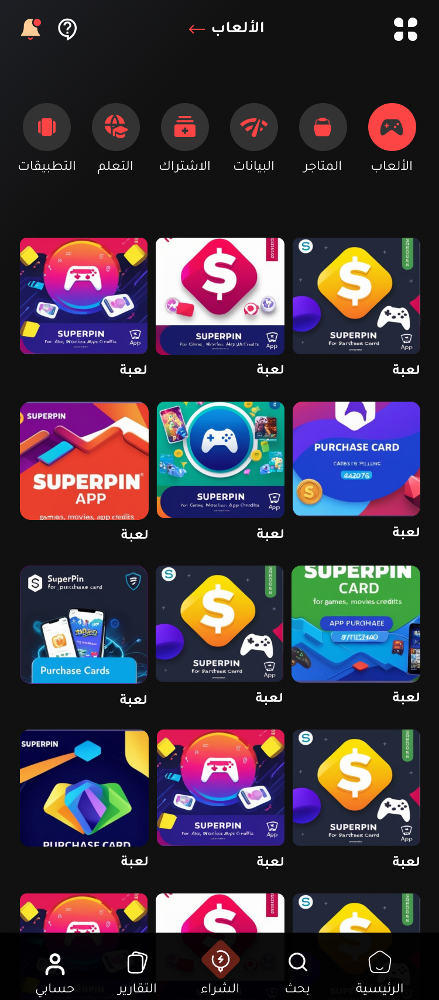
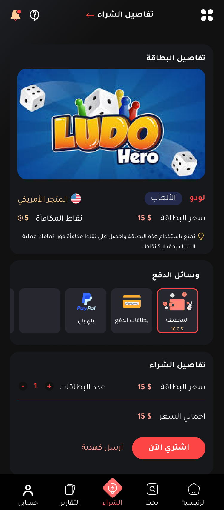
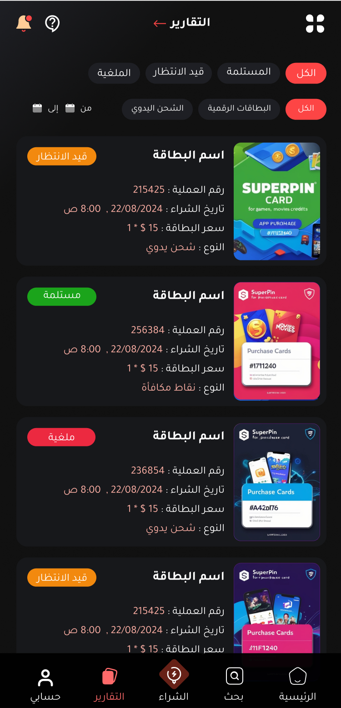

# OK-PIN: Digital Products Marketplace Platform

## Description

OK-PIN is a cutting-edge digital marketplace platform designed specifically for gaming and digital product ecosystems. Built on Laravel, the platform creates a secure environment for users to buy, sell, and trade digital assets including game vouchers, gift cards, account top-ups, and user-to-user digital product sales.

## Overview

This platform addresses the growing demand for a specialized marketplace focusing exclusively on digital products, offering robust KYC verification, multiple payment options, and a complete administrative backend. OK-PIN supports multi-language functionality, making it accessible to a global audience, while maintaining strict security standards for digital transactions.

The system features a modular architecture that allows for seamless scaling and feature expansion as user demand grows. With its intuitive user interface and comprehensive backend management tools, OK-PIN serves both casual users and power sellers in the digital product space.

## Key Features

### 🏠 Modern, Responsive Interface

The platform features a clean, responsive design that works seamlessly across desktop and mobile devices, with customizable themes and multi-language support.

  

### 🎮 Game Vouchers & Digital Services

Browse and purchase digital vouchers for popular games and online services with multiple tier options. The platform handles code generation, redemption tracking, and featured promotion of popular items.

  

### 💵 Top-Up Services

Direct top-up services for gaming accounts, mobile credits, and online platforms. The system features service categorization, price management with discount options, and integration with mobile app stores.

  

### 🛒 Streamlined Purchasing Experience

Intuitive buying process with cart functionality, multiple payment options, and secure transaction processing. The platform manages the entire purchase flow from selection to digital delivery.

  

  

### 👤 User Management & KYC System

Comprehensive user profile management with KYC verification for enhanced security. Features include document upload functionality, admin approval process, and detailed user transaction history.

  

### 📊 Comprehensive Reporting & Analytics

Detailed reporting system for tracking purchases, sales, wallet transactions, and account activity. Users and administrators can generate custom reports and export data as needed.

  

## Security Features

Security was a core focus in this project due to the nature of digital goods and fraud risk.

- KYC verification system with multiple document type support
- Secure payment processing with transaction encryption
- Admin role-based access control system
- Real-time transaction monitoring and verification
- Comprehensive activity logging and security auditing
- Secure wallet system for handling user funds

## License

This project is under private client delivery and is for **showcase purposes only**.  
For details, see the [LICENSE](LICENSE) file.
